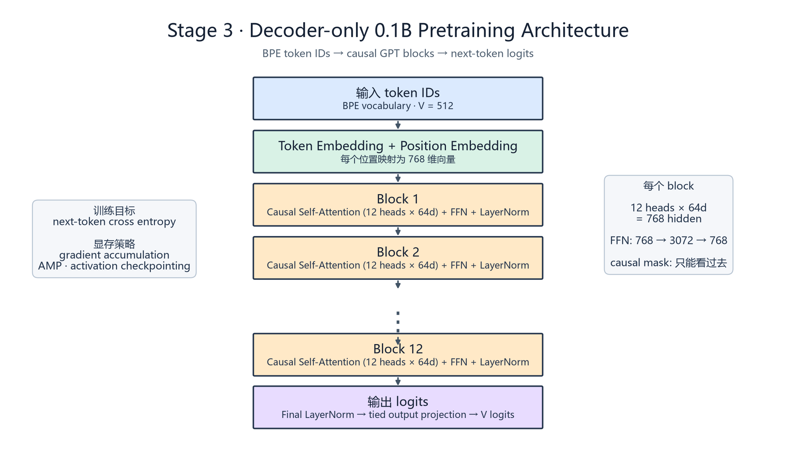

# 0.1B 端到端预训练

状态：**已实现（implemented；smoke 已跑通，0.1B 配置可扩展）**。

使用阶段一 BPE、阶段二 GPT，在 `eng_fra_songs.txt` 上完成端到端数据管线、混合精度/梯度累积/激活重计算、checkpoint、PPL 和轻量 next-token 下游代理评测。默认 smoke 配置用于单卡先跑通；`--profile 0.1b` 提供约 0.1B 参数规模配置。

## 目录约定

- `scripts/`：核心实现、训练、评测与阶段验收脚本。
- `data/raw/`：原始 `eng_fra_songs.txt`；`data/processed/`：token ID 缓存。
- `logs/`：运行输出、配置、指标、PPL/下游评测、架构图和实验记录。
- `curves/`：真实训练 loss 曲线。

## 验收

在仓库根目录执行：

```powershell
python 03_pretraining/scripts/check_stage.py
```

阶段验收脚本检查核心训练、评测、数据管线、配置、loss 曲线和 checkpoint。

预期交付：

- `scripts/train.py`
- `scripts/evaluate.py`
- `scripts/data_pipeline.py`
- `logs/training_metrics.csv`
- `logs/ppl_and_downstream.json`
- `logs/model_architecture.png`
- `curves/training_loss.png`

## 一键复现

在仓库根目录执行以下命令，默认使用单卡/CPU smoke 配置：

```powershell
python 03_pretraining/scripts/train.py --profile smoke --steps 80 --eval-interval 20
python 03_pretraining/scripts/evaluate.py --checkpoint 03_pretraining/models/checkpoint_step_000080.pt
```

要切换到约 0.1B 参数配置：

```powershell
python 03_pretraining/scripts/train.py --profile 0.1b --device cuda --amp --activation-checkpointing
```

`--grad-accum` 由 profile 配置控制；AMP 只在 CUDA 上启用，激活重计算通过阶段二 GPT block 的 checkpoint 路径启用。显存不足时优先降低 `--batch-size`、提高梯度累积、开启 `--amp` 和 `--activation-checkpointing`，再降低 `--block-size`。

## 真实产物与限制

smoke run 的训练指标、PPL、next-token accuracy 和 checkpoint 均由实际运行生成。`ppl_and_downstream.json` 中的 next-token accuracy 是 held-out 轻量代理任务，不代表通用下游 benchmark。0.1B profile 已提供模型结构和可复现命令，但本次只完成小规模 smoke 收敛验证，完整 0.1B 长程训练仍需 CUDA 资源和更大语料。

模型架构图：



实验记录见 [`logs/2026-10-11_stage3_pretraining.md`](logs/2026-10-11_stage3_pretraining.md)。

下一阶段：04_systems_scaling。
