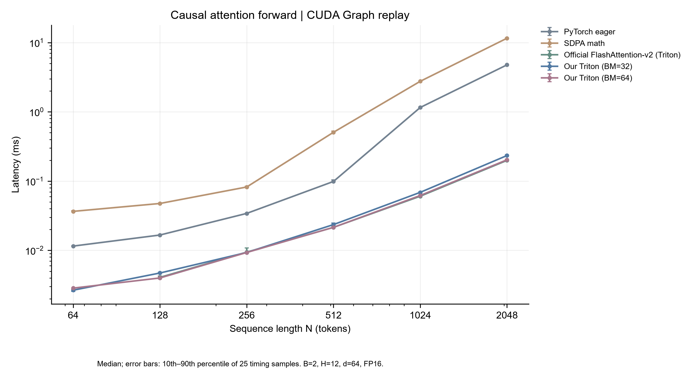

# 阶段四 · 单卡注意力内核与 Scaling Law

状态：**implemented（单卡范围已实测）**。多卡、DDP、ZeRO、多卡训练脚本与加速比全部按用户要求取消。

实现了在线 softmax Triton attention forward，完成 108 项正确性检查、PyTorch/官方 FlashAttention-v2 参考吞吐对照和真实 profiling；运行 5 个模型 × 5 档数据 × 3 个 seed 的 75 组 GPT 消融，并交付已执行的拟合 notebook。

## 一键复现

在**仓库根目录**运行。推荐 Python 3.11、NVIDIA CUDA GPU；本次使用 Windows、RTX 4070 Ti 12GB、PyTorch 2.8.0+cu128、triton-windows 3.4.0.post21。Windows 需安装兼容 CUDA 驱动，Triton 首次运行会编译内核。Linux 对应 Triton 3.4.0；Linux 路径尚未实机验证。

```powershell
python -m venv .venv
.\.venv\Scripts\python.exe -m pip install torch==2.8.0 --index-url https://download.pytorch.org/whl/cu128
.\.venv\Scripts\python.exe -m pip install -r 04_systems_scaling/requirements.txt
$env:PYTHONUTF8 = '1'
.\.venv\Scripts\python.exe 04_systems_scaling/scripts/run_stage4.py
```

最后一条命令完成正确性检查、benchmark、75 组训练、profiling 截图、拟合、绘图、执行 notebook 和证据验收。默认重新训练并覆盖本阶段派生产物，原始数据不改；先另存需要保留的实验日志。`--resume` 跳过同一 config 下已写入 CSV 的训练，不能从中断的单次 run 继续优化器状态。

截图自动寻找 Edge/Chrome；无浏览器时先安装 Chromium 或传入 `--browser "浏览器可执行文件路径"`。Linux 下使用对应 venv 的 `bin/python`。

已有 CUDA 项目环境可直接使用对应 Python。本机大依赖缓存按父工作区 `Use-ProjectEnv.ps1` 留在 D:；仓库复现不依赖这个父目录文件。

仅重算归档指标、曲线和 notebook，**无需 GPU、无需重新训练**：

```powershell
python 04_systems_scaling/scripts/run_stage4.py --analysis-only
python 04_systems_scaling/scripts/check_stage.py
```

分析模式使用已归档 benchmark、训练 CSV、trace 和截图，不声称重新验证 GPU 性能。CPU 环境可只安装 numpy、matplotlib、scipy、nbformat、nbclient、ipykernel。

## 注意力内核与测量范围

- [attention_kernel.py](scripts/attention_kernel.py)：分块 QK、在线 max/sum 归一化、FP32 累加与 PV 融合，避免显式 N×N score buffer。
- 连续 `[B,H,N,D]` CUDA 张量，FP16/BF16，D=32/64/128；支持 causal/noncausal、非整块长度，BM/BN=32/64。
- **forward/inference 学习内核**，无 dropout/backward，不接入训练 autograd；GPT 消融保留阶段二可求导实现。
- [benchmark.py](scripts/benchmark.py)：FP32 SDPA MATH 参考、atol/rtol=0.02，108 个 dtype/head-dim/长度/causal 组合；另检查未来 K/V 扰动不影响早期输出。
- B=2、H=12、D=64、N=64–2048；预热 20 次、25 样本 × 10 调用；分别测 host launch 和 CUDA Graph replay。误差条为样本 P10–P90。
- Windows PyTorch **未编译 SDPA FLASH**，强制调用错误单独保存。FlashAttention 对照是官方 Triton v3.2.0 教程的 FlashAttention-v2 实现，未运行 `flash-attn` 包；N=64 不满足参考整块条件，明确缺测。

完整结果见 [attention_speed_report.md](logs/attention_speed_report.md)。N=2048、CUDA Graph 下 BM64 约 0.203 ms，相对 eager 约 23.5×；官方参考约 0.199 ms，本实现接近但稍慢。这些是 forward 微基准，不能当作训练加速比。



[Profiling 截图](logs/profiling_screenshot.png) 为 Edge 对真实 torch.profiler 表的截图，保留 [trace](logs/attention_trace.json)、[算子表](logs/profiler_table.txt) 和 [来源记录](logs/profiling_capture.json)；没有将它标为 Nsight。

## Scaling 实验设计

[run_scaling.py](scripts/run_scaling.py) 复用阶段一 `BPETokenizer` 类、阶段三保存的 512 词 BPE 模型和阶段二 `GPT/GPTConfig`。语料为阶段二归档 tinyShakespeare；本阶段不改变阶段三的预训练语料或模型。

| 模型 | layers / heads / width | 总参数 N |
| --- | --- | ---: |
| n1 | 2 / 2 / 64 | 141,056 |
| n2 | 2 / 3 / 96 | 285,312 |
| n3 | 3 / 4 / 128 | 676,992 |
| n4 | 3 / 6 / 192 | 1,457,856 |
| n5 | 4 / 8 / 256 | 3,323,392 |

N 包括全部实际参数。D=8,192 / 16,384 / 32,768 / 65,536 / 131,072 个**训练子集位置预算**，不是累计训练 token。每组 2 epochs、context=128、batch=8、BF16、AdamW lr=0.001、weight_decay=0.1、warmup+cosine、clip=1；seed=1337/2026/42。每轮不使用末尾不完整 block，实际 tokens_seen=2×(D−128)。

原文编码后共 841,259 tokens；最后 8,192 tokens 固定验证，训练子集从开头截取，中间留有大段间隔。验证窗口始终相同且不重叠训练位置。原文和 tokenizer SHA-256、split 均归档。子集为嵌套连续切片，数据量、内容组成与训练步数仍有混杂。

```text
L(N,D) = E + A × (N/1e6)^(-alpha) + B × (D/65536)^(-beta)
E ≈ 0, A = 0.664971, alpha = 0.353336
B = 2.676389, beta = 0.218175
```

仅用较小 4×4=16 个 cell 拟合，最大 N 或最大 D 的整档 9 个 cell 留出，每 cell 有 3 seeds。预设门槛是**平均**相对误差 ≤10%；实测 MAPE=5.17%、最差=13.04%，不意味着所有点低于 10%。固定 D=65,536 的 L(N) 和固定 N=1,457,856 的 L(D) 留出误差分别 0.14% 和 3.15%。

E 触及非负下界，不能解释为真实不可约损失。100 次 bootstrap 仅在各 cell 内重采样 seed，不覆盖模型设定、语料域、拟合形式误差。2 epochs 的结果不能称为收敛或 compute-optimal scaling law。

N=0.1B、D=1,000,000 预测 loss≈1.608，仅为远距离外推假设，**未验证且无法保证误差**。阶段三的 0.1B 数据和训练协议不同，不能用来校准此预测。下一步需在相同协议下增加中间规模、训练步数，再用未参与拟合的更大模型验证。


## 产物入口

| 产物 | 路径 |
| --- | --- |
| 配置与环境 | [config.json](config.json)、[environment.json](logs/environment.json)、[依赖版本](logs/dependency_versions.json) |
| 原文、来源和哈希 | [data/raw](data/raw/README.md)、[manifest.json](data/manifest.json) |
| Token 与分割 | [data/processed](data/processed/README.md) |
| 75 组指标 / 训练记录 | [scaling_runs.csv](logs/scaling_runs.csv)、[scaling_training.jsonl](logs/scaling_training.jsonl) |
| 系数与误差 | [scaling_fit.json](logs/scaling_fit.json)、[fit_scaling.py](scripts/fit_scaling.py) |
| 已执行 notebook | [scaling_law.ipynb](notebooks/scaling_law.ipynb) |
| 实验记录 | [2026-10-19_stage4_systems_scaling.md](logs/2026-10-19_stage4_systems_scaling.md) |
| 速度报告 | [attention_speed_report.md](logs/attention_speed_report.md) |
| 曲线及 QA | [curves/README.md](curves/README.md)、[figure_qa.md](logs/figure_qa.md) |
| 复现验收 | [check_repro.py](scripts/check_repro.py)、[reproducibility_check.json](logs/reproducibility_check.json) |
| GitHub 上传回执 | [github_publication_2026-10-19.json](logs/github_publication_2026-10-19.json)，核验前一内容提交 |

75 组训练用于消融和拟合，保存指标而不保存所有权重；复现会重新训练。阶段三 checkpoint 保持原样。下一阶段 `05_posttraining` 本次未开展。
