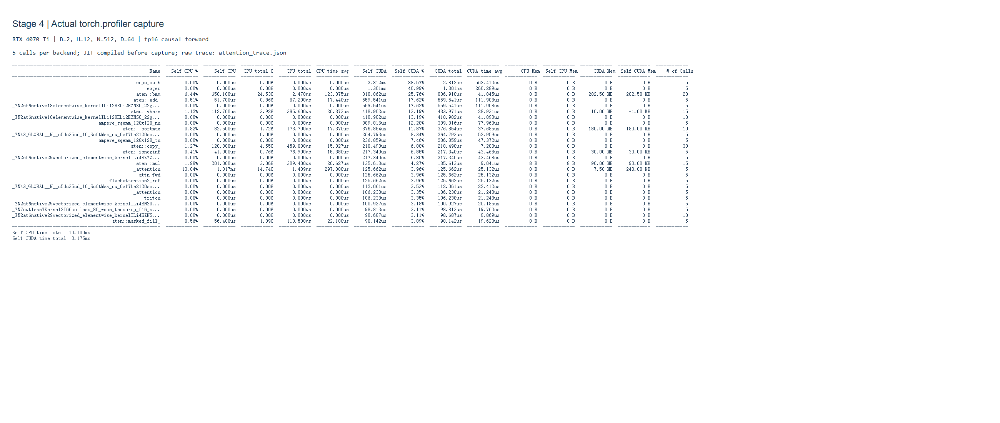
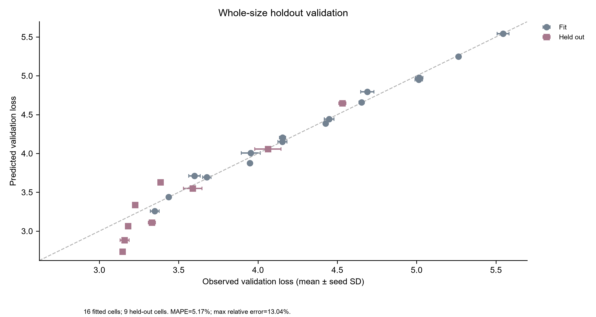

# 阶段四实验记录

## 做了什么

1. 在 RTX 4070 Ti 12GB 的 Windows CUDA 环境安装 triton-windows 3.4.0.post21，编写 [在线 softmax attention](../scripts/attention_kernel.py)。先进行 108 个 FP16/BF16、head_dim、长度和掩码组合的正确性对照，再进行性能测试；对未来 K/V 扰动的因果性检查也通过。参考为 FP32 SDPA MATH，atol/rtol=0.02。
2. 比较 eager、强制 SDPA MATH、官方 Triton FlashAttention-v2 教程、手写 BM32/BM64；分别测 host launch 与 CUDA Graph。每项预热 20 次，25 个样本 × 10 调用。先 JIT 预热再用 torch.profiler 采集真实 CPU/CUDA 算子、导出 trace，并由 Edge 对实际结果截图。
3. 复用阶段一 BPE 实现、阶段三保存的 512 词表和阶段二 GPT 类，tinyShakespeare 上运行 5 个参数规模 × 5 档数据位置预算 × seeds 1337/2026/42，共 75 组。配置见 [config.json](../config.json)，完整指标见 [scaling_runs.csv](scaling_runs.csv)，过程 loss/lr 见 [scaling_training.jsonl](scaling_training.jsonl)。
4. 固定末尾 8192-token 验证切片，训练最多使用开头 131072-token 子集；保存原文/词表哈希和分割清单。每组训练 2 epochs、context=128、batch=8、BF16，AdamW + warmup/cosine + clip。D 是位置预算，实际累计 tokens_seen=2×(D−128)。
5. 仅用较小 4×4 个 cell 拟合联合幂律，最大参数档或最大数据档整组留出，共 9 个 holdout cell。另拟合固定 D 的 L(N) 和固定 N 的 L(D)，执行 [notebook](../notebooks/scaling_law.ipynb)，导出原始点、拟合和外推曲线。

## 结果是什么

| 检查或测量 | 实测结果 |
| --- | --- |
| 正确性 | 108/108 + 因果扰动不变性通过 |
| N=2048 BM64 CUDA Graph forward | 约 0.2029 ms |
| 相对 eager / SDPA math | 23.50× / 56.95× |
| 官方 FlashAttention-v2 Triton 参考 | 约 0.1991 ms，手写内核稍慢 |
| 训练 | 75/75 组完成，全部最终验证 loss 低于初始值 |
| 联合拟合 RMSE | 0.055995 nats/token |
| 9 个整档留出 cell 的平均相对误差 | 5.17%，通过预设平均 ≤10% 门槛 |
| 留出最大相对误差 | 13.04%，没有保证每点误差 ≤10% |
| L(N) / L(D) 整档留出误差 | 0.14% / 3.15% |

联合系数与归一化为：

```text
L = E + A*(N/1e6)^(-alpha) + B*(D/65536)^(-beta)
E = 4.2331e-22 (触及非负下界)
A = 0.664971, alpha = 0.353336
B = 2.676389, beta = 0.218175
```

单变量拟合形式 `E+A*(x/x0)^(-alpha)`：L(N) 固定 D=65536，x0=1e6，E=3.305394、A=0.077704、alpha=1.082239；L(D) 固定 N=1457856，x0=65536，E=1.941714、A=1.400480、alpha=0.324887。完整精度、100 次 seed bootstrap 区间和各 cell 预测见 [scaling_fit.json](scaling_fit.json)。





[完整速度/显存报告](attention_speed_report.md)、[原始 benchmark CSV](benchmark_metrics.csv)、[Chrome trace](attention_trace.json)、[图表 QA](figure_qa.md) 支持复核。6 张最终 PDF 的文字与碰撞审查通过；notebook 已执行且没有 error 输出；归档证据检查见 [reproducibility_check.json](reproducibility_check.json)。

## 调试与限制

- Windows PyTorch 2.8.0+cu128 未编译 SDPA FLASH，强制调用失败后单独记录，未将 math fallback 标成 FlashAttention。替代对照为上游官方 Triton FlashAttention-v2 教程；该参考 N=64 缺测明确保留。没有运行独立 `flash-attn` 包。
- 同时保存 launch 和 CUDA Graph 结果，避免把 Python 提交空隙完全解释成 GPU 内核差距。Profiler 的插桩时间仅用于定位算子，不用于计算加速比。截图来自实际 profiler 表，不是 Nsight。
- 内核只有 inference forward，没有 backward/dropout；没有声称它加速阶段三训练。所有多卡任务均按用户要求取消。
- 2 epochs 不足以研究收敛或 compute-optimal scaling。嵌套子集的内容、步数和 D 同时变化；只测一个文学语料和一个验证切片，不能推断跨语料通用规律。
- E 触及下界说明当前数据不足以辨识物理 loss floor；bootstrap 仅覆盖 seed 随机性。N=0.1B、D=1e6 外推 loss≈1.608，seed-only 95% 区间约 [1.568,1.669]，**尚未验证且不构成泛化误差界**。阶段三不同语料/协议的 0.1B checkpoint 不用于校准。
- 不承诺跨 GPU/驱动的 bitwise 相同数值；复现以相同配置、可核验数据与合理数值接近为目标。75 次小模型只保存指标，不保存全部权重；阶段三 checkpoint 未改。

## 下一步是什么

先在同一语料和训练协议下增加中间 N/D 档位，并延长训练到足够稳定；对新的整档留出规模重新验收误差，再考虑 0.1B 实测校准。若继续优化内核，应先补 backward、梯度正确性与数值稳定性，再做端到端训练评测。本次不启动多卡工作。

一键复现和分析重算见 [阶段 README](../README.md)。原始数据保持只读归档，不修改其他已完成阶段。
