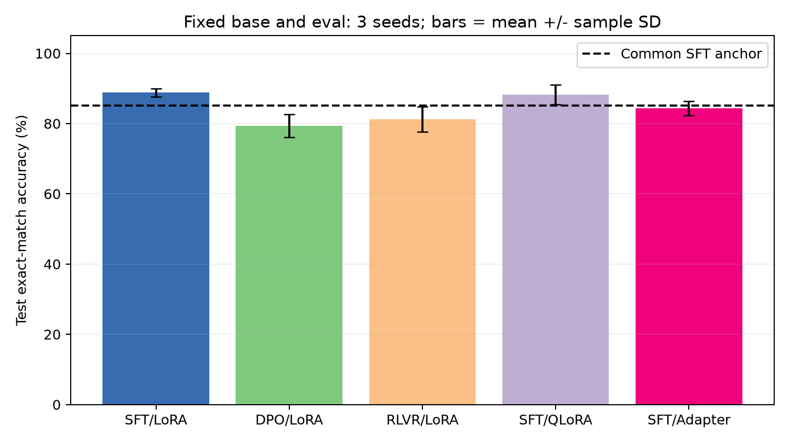
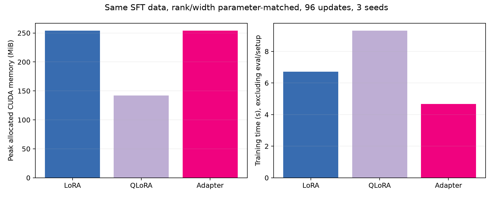

# 后训练与对齐

状态：**已实测，单卡小规模后训练对照**。复用阶段三约 8555 万参数 GPT；一次共享 SFT 预热后，固定基座、数据划分、评测与训练预算，完成 5 个实验臂 × 3 seeds，共 15 次运行。

固定基座后进行 SFT / DPO / RLVR 对照；同一 SFT 数据上比较 LoRA / NF4 QLoRA / Adapter。实验任务为可精确验分的整数比较，不能据此宣称获得通用人类偏好对齐能力。

## 一键复现

需要 NVIDIA CUDA、支持 BF16 的 GPU、Python 3.11 和仓库已归档的阶段三 checkpoint 分片。已在 Windows、RTX 4070 Ti 12GB、PyTorch 2.8.0+cu128 上实测，无需 transformers、TRL 或 PEFT 库，也不需要下载新基座。

在仓库根目录执行，使用自己的独立环境：

```powershell
python -m venv .venv
.\.venv\Scripts\python.exe -m pip install torch==2.8.0 --index-url https://download.pytorch.org/whl/cu128
.\.venv\Scripts\python.exe -m pip install -r requirements.txt -r 05_posttraining/requirements.txt
$env:PYTHONUTF8 = '1'
$env:CUBLAS_WORKSPACE_CONFIG = ':4096:8'
.\.venv\Scripts\python.exe 05_posttraining/scripts/run_stage5.py
.\.venv\Scripts\python.exe 05_posttraining/scripts/check_repro.py --reload
```

第一条脚本命令会生成确定性数据、训练共享预热基座、依次运行 15 个独立进程，生成指标表、曲线和详细报告。`--resume` 可跳过已完成的运行；仅适用于未修改 config、代码与数据的中断恢复。配置或实现变化后重新完整运行，保留旧实验时另建归档。

已有环境可只执行训练与验证两条命令。CUDA 驱动、GPU 后台负载和版本会影响时长与显存，种子不能保证跨硬件逐位一致。小模型实验在单卡运行，多卡任务保持取消状态。

## 数据、基座与评测

- `data/raw/comparisons.jsonl` 穷举 00–31 的 1024 个有序数对，自行生成，按 CC0-1.0 归档。训练 768、验证 128、测试 128，按标签分层，同一题不跨 split。
- tokenizer 为阶段三所用的阶段一 BPE 实现，词表 512；基座权重来自 `03_pretraining/models/best_checkpoint*.pt`。数据与所有权重分片 SHA-256 见 `data/manifest.json` 和 `logs/protocol.json`。
- 共享预热为 240 步 LoRA SFT，合并后得到所有实验的同一固定基座。各方法再训练 96 次更新，使用最终预算 checkpoint；验证集只监控，测试不参与调参或选模型。
- 测试从完整词表贪心生成最多 2 tokens，解码并去除两端空白，精确匹配 `0` 或 `1`。默认特殊 token 按 tokenizer 规则跳过，`<unk>` / 无效 UTF-8 判错；不使用限制答案词表的分类准确率。
- SFT 为 response-only CE。DPO 含冻结参考基座的正确/错误回答 log-prob 差。RLVR 采用 on-policy 组内归一化奖励、clipped policy objective 和冻结参考 KL；奖励仅来自生成回答的精确 verifier。
- 三个 PEFT 方法的可训练参数均为 442,368。QLoRA 使用 bitsandbytes NF4 双重量化及真实 UINT8 packed 权重，embedding / 共享输出头保留 BF16，优化器为普通 AdamW。

## 结果与产物

- [详细对照报告与掉点判定](logs/posttraining_report.md)
- [统一逐次实验表](logs/evaluation_metrics.csv) 与 [三 seed 汇总表](logs/summary_metrics.csv)
- [固定协议、环境与基座哈希](logs/protocol.json)
- [全部实验登记，含预热、基座评测与失败尝试](logs/experiment_registry.csv)
- [逐题生成与完整训练轨迹](logs/runs/)
- [Checkpoint 清单与哈希](models/manifest.json)，16 份小型 PEFT 增量；加载时按顺序重建阶段三权重、共享预热与最终增量。
- [复现检查](logs/reproducibility_check.json)





## 单独运行与重载

```powershell
python 05_posttraining/scripts/train_sft.py --peft lora --seed 1337
python 05_posttraining/scripts/train_dpo.py --seed 1337
python 05_posttraining/scripts/train_rlvr.py --seed 1337
python 05_posttraining/scripts/train_sft.py --peft qlora --seed 1337
python 05_posttraining/scripts/train_sft.py --peft adapter --seed 1337
python 05_posttraining/scripts/evaluate.py --checkpoint 05_posttraining/models/sft_lora_s1337.pt
python 05_posttraining/scripts/test_methods.py
```

单臂命令需要先有数据划分与共享预热 checkpoint。`compare_peft.py` 复用完整套件入口，避免为 PEFT 对照意外改变数据或评测。主结果固定 96 步；单臂修改 `--steps` 只用于额外探索，应另行保存结果。

显存记录 PyTorch 训练峰值 allocated 与 reserved，耗时包含训练 step、RLVR rollout 和同步，排除 setup 与 eval，分别登记。各方法固定更新数但计算量不同。掉点阈值在 config 中预设为相对 SFT-LoRA 下降超过 2.5 pp，探索性区间与限制见报告。

文本来源的 JSON 哈希使用 UTF-8 LF 规范化，raw 和二进制按原始字节校验。首次运行 checkpoint 元数据保留原运行时的文本字节指纹，可迁移指纹以 `logs/protocol.json` 为准，数值权重未被修改。

## 目录约定

- `scripts/`：核心实现、训练、评测与阶段验收脚本。
- `data/raw/`：原始数据；`data/processed/`：派生数据。
- `logs/`：运行输出、配置、指标和实验记录。
- `curves/`：由真实指标生成的 loss、验证准确率、后训练对照和 PEFT 资源图。

## 验收

在仓库根目录执行：

```powershell
python 05_posttraining/scripts/check_stage.py
```

核心产物存在性由阶段门禁检查；数据隔离、15 次实际运行、NF4 存储和 checkpoint 重载由 `check_repro.py --reload` 验证。

预期交付：

- `scripts/train_sft.py`
- `scripts/train_dpo.py`
- `scripts/train_rlvr.py`
- `logs/evaluation_metrics.csv`
- `curves/alignment_comparison.png`

下一阶段：06_agent。
