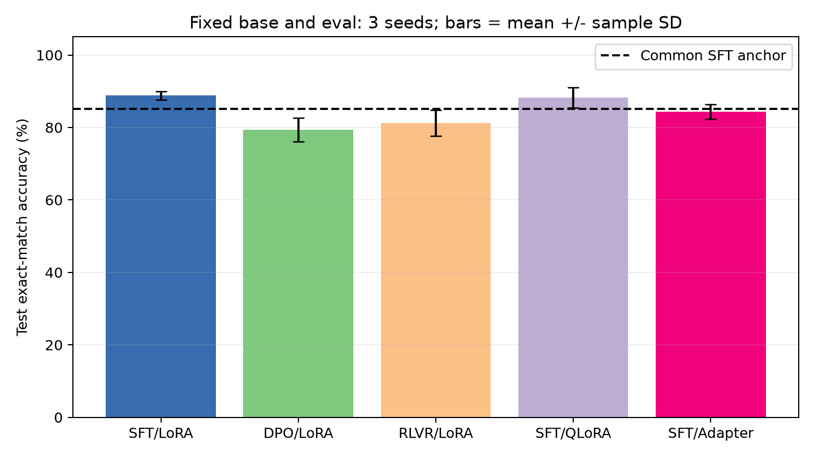
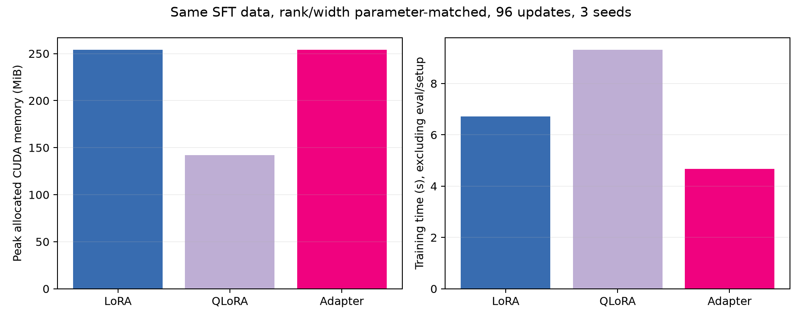
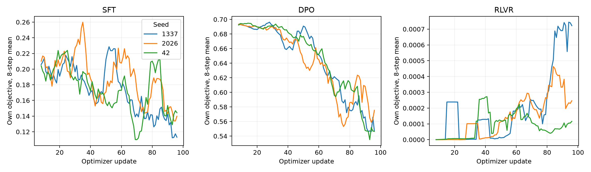

# 2026-11-01 阶段五实验记录

记录时区为 Asia/Hong_Kong（UTC+08:00），实际环境时间见 [protocol.json](protocol.json)。

## 做了什么

按用户规划，在阶段三 85,547,520 参数 checkpoint 上用同一份 512 词表 BPE，构建了 response-only SFT、带冻结参考的 DPO，以及基于 on-policy 采样和精确奖励的组相对 RLVR。先训练共享 LoRA SFT 240 步并合并为固定基座，再运行 5 个实验臂 × 3 seeds，每次 96 次更新。

自行穷举生成整数比较任务 1024 条，CC0-1.0，按题目隔离训练 768、验证 128、测试 128。所有方法只用 train 更新；validation 只监控，test 在最终固定预算权重上贪心生成，不用于选参。SFT、DPO 和 RLVR 都用 LoRA；PEFT 横比固定同一 SFT 数据、训练步数和 442,368 个可训练参数。

QLoRA 安装并使用 bitsandbytes 0.48.2 Windows wheel，48 个冻结线性层使用 NF4、双重量化和真实 UINT8 packed 存储。没有将 FP16/BF16 fake quant 标作 QLoRA。全部实验在 RTX 4070 Ti 单卡运行，没有多卡任务。

## 结果是什么

共同基座准确率 85.16%。三 seed 平均结果如下，完整明细与探索性区间见 [对照报告](posttraining_report.md)。

| 实验臂 | 测试准确率 % | 训练峰值 allocated MiB | 训练秒 | 相对 SFT-LoRA 掉点 pp |
| --- | --- | --- | --- | --- |
| SFT-LoRA | 88.80 | 254.3 | 6.72 | 0.00 |
| DPO-LoRA | 79.43 | 261.5 | 13.38 | 9.38 |
| RLVR-LoRA | 81.25 | 428.1 | 14.69 | 7.55 |
| SFT-QLoRA | 88.28 | 142.2 | 9.32 | 0.52 |
| SFT-Adapter | 84.38 | 254.3 | 4.68 | 4.43 |

预设规则是掉点超过 2.5 pp 下岗，因此本轮保留 LoRA、QLoRA，淘汰 DPO、RLVR、Adapter。Adapter 的探索性掉点区间跨零，这一判定是固定阈值下的工程选择，不是显著性结论。QLoRA 相对 LoRA 训练峰值 allocated 约低 44.1%，平均训练时间约高 38.7%。

显存为 PyTorch allocated，另存 reserved；不含 CUDA context 和其它 GPU 进程。训练耗时包含 RLVR rollout 与同步，排除加载、参考缓存和评测，其 setup 成本另存。共同预热另记，不分摊到每个实验臂。不同目标的计算量未做等 FLOPs 控制。

## 调试与验证

最初环境缺少 tzdata 导致时区初始化失败，使用 Python 标准库 UTC+08:00 固定偏移记录 Asia/Hong_Kong 时间，不引入额外依赖。RLVR seed 42 首次运行在第 71 次更新前采样到 `<unk>`，可逆 tokenizer 的解码器按设计拒绝还原，导致训练中断。已保留 [失败 console](debug/rlvr_unknown_token_console.txt) 与 [70 步部分轨迹](debug/rlvr_partial_training.jsonl)，将不可解码回复判为无效、奖励为零后，从该 seed 的相同初始化重新运行完 96 步。

另修复 Windows CRLF 与 Git LF 换行导致的文本指纹不一致。派生 JSON 固定输出 LF，阶段三 JSON 来源的可迁移哈希先规范化 LF，raw 与二进制仍按精确字节校验；不改变数据内容或已训练权重。

7 项方法测试覆盖数据隔离、回复 mask、DPO 方向、组内奖励、LoRA 梯度、真实 NF4 反向传播与 `<unk>` 回归，见 [method_tests.txt](method_tests.txt)。复现检查核验所有 15 次轨迹、权重变化和逐题准确率；五个实验臂各重载 seed 1337 权重，逐题生成及 token IDs 与原记录一致，见 [reproducibility_check.json](reproducibility_check.json)。共归档 16 份增量 checkpoint，均在数 MB 以内，基座直接复用原仓库分片。

统一逐次结果见 [evaluation_metrics.csv](evaluation_metrics.csv)，包含预热、固定基座评测和失败记录的总登记见 [experiment_registry.csv](experiment_registry.csv)。

## 下一步是什么

任务仅为窄域整数比较，不能作为通用人类价值对齐结论。后续增加数学与代码等可验证任务，使用更多 seed 并分别预热，再控制有效 token/计算预算，检验本轮资源与掉点结论。保留独立测试集，避免针对当前测试成绩调参。

报告整理使用 human-writing 初稿和 sepia refactor，指标来自实际运行，没有补造训练点。沿用用户要求，不新增独立 AI 使用记录文件。
