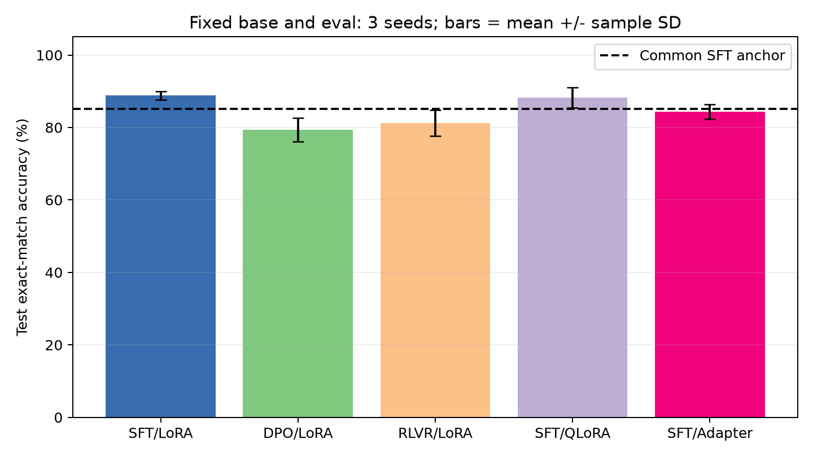
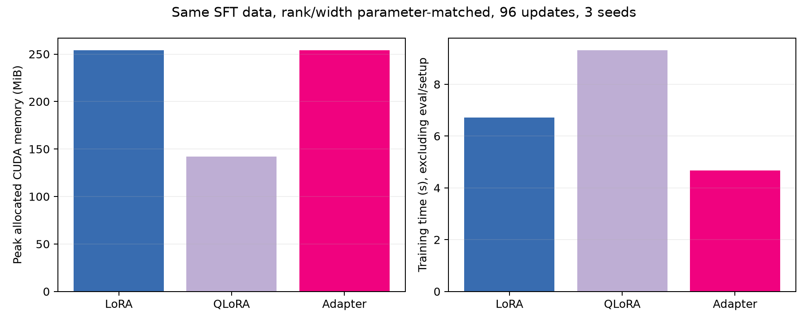
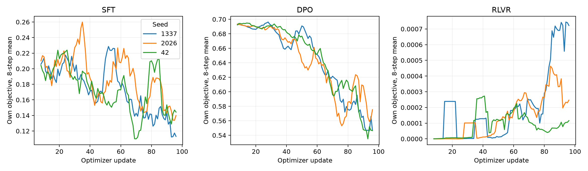

# 阶段五后训练与 PEFT 对照实验报告

## 数据与统一协议

复用阶段三的 85,547,520 参数 GPT 与 512 词表 BPE。先进行一份共享 SFT 预热，再合并其 LoRA 增量作为全部实验的固定基座。任务是 00–31 的整数比较，回答 0 或 1，按有序数对去重并分层划分训练、验证、测试集。数据、划分、基座分片及 tokenizer 的 SHA-256 见 manifest 与 protocol。

固定基座测试准确率为 85.16%。评测对完整词表进行贪心生成，最多 2 tokens，解码后精确匹配；不限制答案候选、不用 teacher forcing 准确率替代生成准确率。只训练回复和 EOS，提示词与 padding 不计 SFT loss。最终固定预算 checkpoint 用于测试，验证集仅监控，不选 checkpoint，不根据测试调参。

## 超参数

| 项目 | 设置 |
| --- | --- |
| Seed | [1337, 2026, 42] |
| 共同预热 | LoRA，240 步，lr=0.001，seed=1337 |
| 各实验预算 | 96 次更新；SFT/DPO batch=16；RLVR 4 prompts × 4 rollouts |
| 学习率 | SFT=0.0003；DPO=0.0001；RLVR=5e-05 |
| 对齐参数 | DPO beta=0.1；RLVR KL=0.02，clip=0.2 |
| PEFT | qkv/proj LoRA rank=8，alpha/r=2；逐 block 残差 Adapter width=24；可训练参数均为 442,368 |
| 精度与优化器 | BF16 基座和算子，FP32 PEFT 参数及 AdamW 状态，lr 恒定，weight decay=0，clip norm=1，activation checkpointing |
| QLoRA | bitsandbytes 0.48.2，NF4，双重量化，UINT8 packed；embedding/共享输出头保留 BF16；标准 AdamW，非 paged optimizer |

SFT、DPO 与 RLVR 都从同一固定基座上新建零输出增量。DPO 使用基座的冻结参考 log-prob 缓存，目标是正确回答优于相反回答。RLVR 在当前策略上从完整词表采样，以精确验分的 0/1 奖励构造组内标准化 advantage，使用 clipped policy objective 和冻结基座 KL；每批只更新一次，不使用标签交叉熵。

## 统一结果表

| 方法 | 测试准确率 %，均值±SD | 掉点 pp，相对 SFT-LoRA | 掉点探索性 95% CI | 显存 MiB | 训练秒 | 规则判定 |
| --- | --- | --- | --- | --- | --- | --- |
| SFT/LoRA | 88.80 ± 1.19 | +0.00 | [+0.00, +0.00] | 254.3 | 6.72 | 保留 |
| DPO/LoRA | 79.43 ± 3.25 | +9.38 | [+2.86, +17.19] | 261.5 | 13.38 | 下岗 |
| RLVR/LoRA | 81.25 ± 3.58 | +7.55 | [+0.26, +14.32] | 428.1 | 14.69 | 下岗 |
| SFT/QLoRA | 88.28 ± 2.82 | +0.52 | [-3.39, +4.69] | 142.2 | 9.32 | 保留 |
| SFT/Adapter | 84.38 ± 2.07 | +4.43 | [-0.52, +9.38] | 254.3 | 4.68 | 下岗 |

完整 15 次运行逐行结果见 [evaluation_metrics.csv](evaluation_metrics.csv)，汇总见 [summary_metrics.csv](summary_metrics.csv)，逐题输出在 `runs/*/test_predictions.json`。

显存为独立进程内训练阶段的 PyTorch peak allocated，包含基座、梯度和优化器；RLVR 还包含冻结参考模型。训练秒包含 backward、优化器、RLVR rollout 和同步，排除模型加载、参考缓存与验证/测试；setup_seconds 另记。reserved 显存也在 CSV 中，不等于全卡或进程的 nvidia-smi 占用。固定更新次数没有让三种对齐方法的 FLOPs 或 token 数相等。

三种 loss 的定义不同，不能横向比较其绝对数值；图中每条线来自实际训练日志。RLVR 每批只更新一次，组内 advantage 均值为零，ratio=1 时策略损失的前向值接近零，仍有非零梯度；需要结合 grad_norm、delta_l2 与生成准确率判断变化。

## 谁掉点谁下岗

预先设定掉点门槛为 2.5 个百分点。按三 seed 平均测试准确率，较 SFT-LoRA 下降超过门槛的方案下岗，其余保留。保留表示通过本次任务门槛，不表示统计等价、通用性能更好或其它任务同样适用。CI 为 2000 次成对题目与 seed 重采样，仅作探索性不确定性描述，3 个 seed 及单一共享预热限制了外推。

本次下岗方案为 DPO/LoRA、RLVR/LoRA、SFT/Adapter。

## 限制与下一步

本实验使用穷举生成的窄域数学判断任务，没有人类偏好标注，不能据此宣称完成通用人类价值对齐。共享 SFT 预热使三种方法起点一致，但它们比较的是预热后的继续训练效果，并非各自从原始阶段三 checkpoint 直接训练的差异。预热成本独立记录，不计入单个增量实验。

下一步应在保持评测集隔离的前提下扩大任务与数据，并为每个随机种子独立预热；增加等 token/计算预算、更多种子和明确置信门槛，验证显存与掉点权衡是否仍成立。
