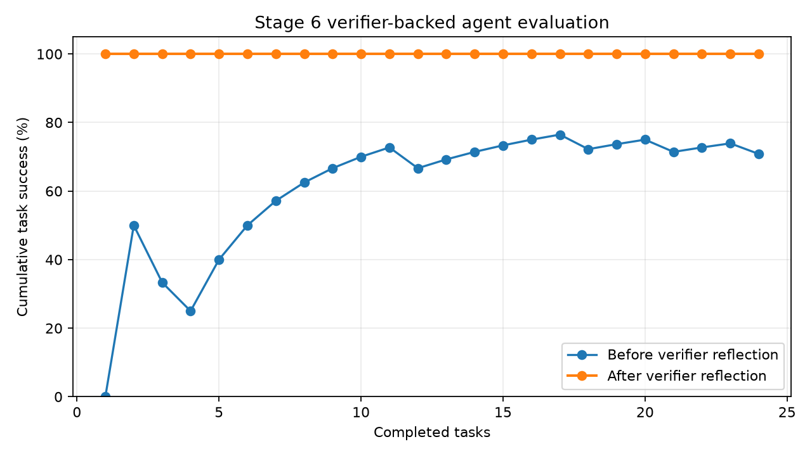
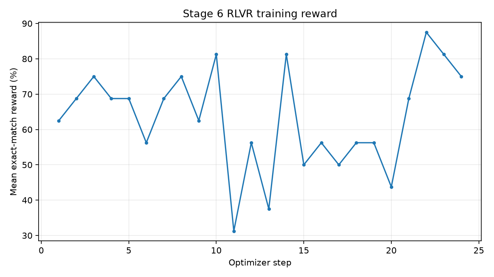

# 2026-11-12 阶段六实验记录

时区为 Asia/Hong_Kong（UTC+08:00）。工程环境为 Windows、RTX 4070 Ti 12GB、Python 3.11、PyTorch 2.8.0+cu128。

## 做了什么

复用阶段三 85,547,520 参数 GPT、阶段五共享 SFT 预热权重和 `rlvr_lora_s1337` 策略初始化，使用阶段五的精确整数比较 verifier 再训练 LoRA 24 步。训练 442,368 个参数，学习率 `5e-5`，BF16；更新目标为阶段五已审查的组相对 RLVR objective。新增策略 checkpoint 为 `models/agent_rlvr_lora_s20261112.pt`。

Agent harness 读取由固定 seed 20261112 生成的 24 个任务。每题从三个互异的 00–31 整数中找出最大的两个并计算总和。固定模板将题目拆成两两比较和加法，比较调用阶段五策略，计算调用 calculator 工具；环境按确切答案判分。任务失败时记录“我为什么答错”，由 verifier 给出比较校正并重算。规划器与工具路由仍是确定性模板。

## 结果是什么

| 指标 | 结果 |
| --- | ---: |
| Agent 测试任务 | 24 |
| 首答端到端完成率 | 70.83%（17/24） |
| verifier 反思纠错后完成率 | 100%（24/24） |
| 比较子任务正确率 | 86.11%（62/72） |
| 子任务失败率 | 13.89%（10/72） |
| 固定模板工具路由正确率 | 100%（24/24） |
| 平均工具调用数 | 4 |
| 反思记录 | 7 |

RLVR 训练日志显示验证准确率从初始 81.25% 到 24 步后的 82.03%，固定测试准确率为 82.03%（128 题）。该小幅变化只作本轮记录，不构成泛化提升结论。训练耗时 3.16 秒，训练峰值 allocated 显存 428.1 MiB。

逐题动作与反思见 [`trajectories.jsonl`](trajectories.jsonl)，配置见 [`../config.json`](../config.json)，聚合指标见 [`metrics.json`](metrics.json)，RLVR 训练控制台与逐步日志分别见 [`training_console.txt`](training_console.txt) 和 [`runs/agent_rlvr_lora_s20261112/training.jsonl`](runs/agent_rlvr_lora_s20261112/training.jsonl)。策略和 tokenizer 哈希在 [`../models/manifest.json`](../models/manifest.json)。

## 下一步是什么

当前任务是短程、封闭式的整数排序求和，规划器与工具路由没有学习；24 题也不足以支持宽泛的成功率结论。下一步可扩展到多类算术、检索和代码验证任务，给规划和选工具加入模型动作与独立奖励，再用更大测试集和多个 seed 报告首答率、反思收益及工具选择准确率。
