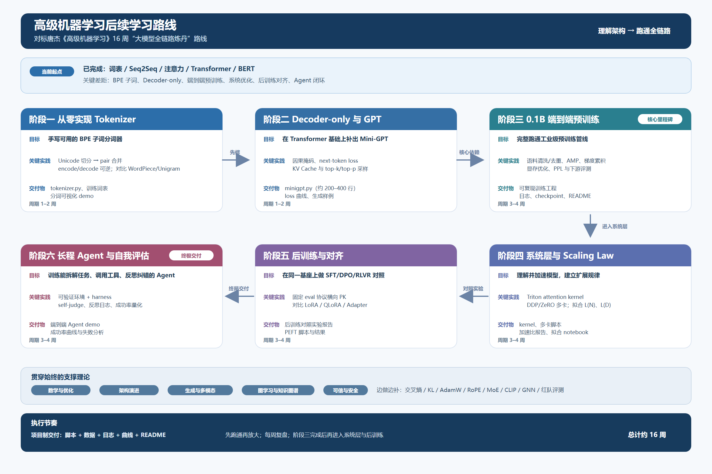

# Full-chain Training of Large Models

按阶段归档大模型全链路学习代码、数据、日志、曲线和实验记录。目前阶段一 Tokenizer、阶段二 Mini-GPT 与阶段三单卡 CUDA 预训练工程已实现；阶段四至六保留规划目录与验收清单。



## 阶段与状态

| 目录 | 内容 | 当前状态 |
| --- | --- | --- |
| [01_tokenizer](01_tokenizer/README.md) | 手写 BPE、官方 SentencePiece Unigram、可逆编码、压缩率对照 | 已实现，见真实实验日志 |
| [02_gpt](02_gpt/README.md) | Decoder-only、Mini-GPT | 已实现，见训练曲线与生成样例 |
| [03_pretraining](03_pretraining/README.md) | 0.1B 端到端预训练 | 已实现：非英法语料单卡 CUDA AMP + activation checkpointing |
| [04_systems_scaling](04_systems_scaling/README.md) | Triton、多卡、Scaling Law | 待开展 |
| [05_posttraining](05_posttraining/README.md) | SFT/DPO/RLVR、PEFT | 待开展 |
| [06_agent](06_agent/README.md) | 长程 Agent、自我评估 | 待开展 |
| [09_encoder_decoder](09_encoder_decoder/README.md) | 已有 Seq2Seq、Transformer、BERT 基础代码 | 继承归档；历史训练待复现 |

各阶段统一采用 `scripts/`、`data/raw/`、`data/processed/`、`logs/`、`curves/`、`README.md`；有模型产物的阶段另设 `models/`。原始数据不可覆盖，派生数据单独保存。空白阶段使用说明文件记录缺项，不生成虚构训练曲线。

## 独立安装与复现

推荐 Python 3.11。仓库只包含本学习项目，不依赖父目录的 LangChain/MCP 环境。

```powershell
python -m venv .venv
.\.venv\Scripts\python.exe -m pip install -r requirements.txt
$env:PYTHONUTF8 = '1'
.\.venv\Scripts\python.exe scripts/run_stage1.py
.\.venv\Scripts\python.exe scripts/verify_repository.py
```

`run_stage1.py` 运行 Tokenizer 测试、demo 和五档词表对照，将模型、原始指标、终端日志与曲线保存到本仓库。Encoder-Decoder 训练按需单独运行；CUDA 环境请安装匹配本机的 PyTorch 构建。

阶段三从 `03_pretraining/` 下的单卡 CUDA 工程复现，训练语料不含英法歌曲：

- [阶段三：单卡 CUDA、AMP 与 activation checkpointing](03_pretraining/README.md)

## 实验记录与验收

- [2026-10-09 实验记录](docs/experiments/2026-10-09_repository_and_tokenizer.md)：做了什么、结果是什么、下一步是什么。
- [Tokenizer 结果表](01_tokenizer/logs/comparison_report.md)。
- [Mini-GPT 阶段二实验记录](02_gpt/logs/2026-10-10_stage2_minigpt.md)：因果掩码、loss 下降与生成样例。
- [Mini-GPT loss 曲线](02_gpt/curves/training_loss.png)。
- [阶段三实验记录](03_pretraining/logs/experiment.md)：非英法混合语料、AMP、activation checkpointing、50 steps。
- [统一实验记录模板](docs/experiment_template.md)。
- `stages.json`：阶段状态与预期产物；`logs/repository_verification.json`：结构与数据哈希检查。

每次实验提交包含脚本、数据说明/清单、日志、曲线和阶段 README，记录配置、seed、输入 SHA-256、实际指标与限制。大型 checkpoint 不纳入普通 Git，应登记外部存储与校验值；本次的小型 SentencePiece 模型、原始语料和曲线均归档。
