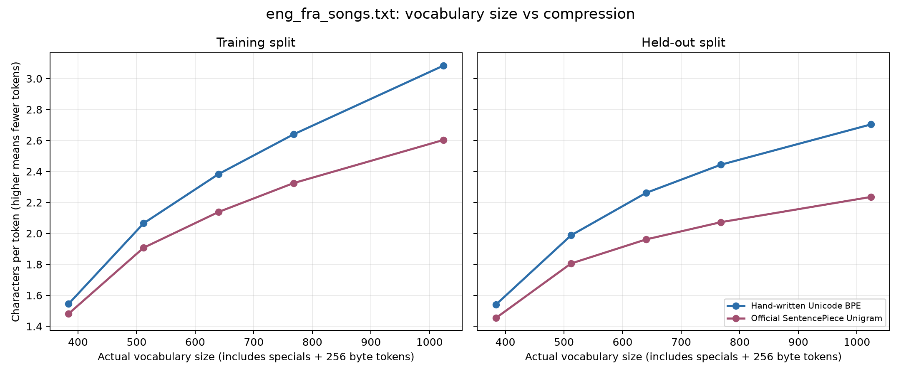

# Tokenizer 复现与阶段仓库整理实验记录

日期：2026-10-09；时区：Asia/Hong_Kong。

## 做了什么

1. 把完整学习项目整理为独立 Git 仓库。阶段一至六分别建目录；09 保留已有 Encoder-Decoder 基础章节。各阶段统一提供 scripts、data/raw、data/processed、logs、curves、README 和验收清单。
2. 将已有代码、原始歌曲数据、训练模型与曲线按用途归档。消除 Encoder-Decoder 中本机绝对路径，改成根据脚本位置解析；保留英文模块 import。
3. 在新目录运行手写 BPE 和官方 SentencePiece Unigram 测试、demo 与五档词表对照。记录各步骤真实终端输出、时间、退出码和环境版本。
4. 固定 seed 42，按句对与重复歌词连通组划分训练/留出数据；避免相同句子出现在两组。两种 tokenizer 都包含四个特殊 token 和 256 个字节回退 token。
5. 建立原始数据清单与 SHA-256 校验，设置 Git 保留 raw 数据字节，避免换行自动转换导致原始数据漂移。

复现命令（仓库根目录）：

```powershell
python scripts/run_stage1.py
python scripts/verify_foundation.py
python scripts/verify_repository.py
```

环境：[环境版本记录](../../logs/environment.json)。逐步运行证据：[reproduction_run.json](../../01_tokenizer/logs/reproduction_run.json)。

## 结果是什么

数据：566 对英法句子，共 1,132 句；904 句训练、228 句留出；完全相同句子的跨组重叠为 0。

原始 `eng_fra_songs.txt` SHA-256：`4d927cb4d2bb2ebbdba1b9914175c05a308a37c5bd0d9ea5b39a03aabafd6ea3`。阶段一归档副本与 09 原始文件一致。

两个 tokenizer 均通过完整歌曲语料及 7 个边界样本的编码/解码检查，包括未知中文与 emoji、连续空格、换行、组合重音、特殊 token 字面量和 SentencePiece 空格标记。没有产生 `<unk>`，模型保存加载后的编码保持一致。

压缩率为总 Unicode 字符数 / 总 token 数，不计额外 BOS/EOS；词表预算包含基础字节 token。

| 实际词表大小 | BPE 留出字符/token | Unigram 留出字符/token |
| ---: | ---: | ---: |
| 384 | 1.5404 | 1.4539 |
| 512 | 1.9874 | 1.8056 |
| 640 | 2.2615 | 1.9610 |
| 768 | 2.4440 | 2.0727 |
| 1024 | 2.7042 | 2.2356 |

本语料中增加词表预算提高了压缩率，BPE 的字符/token 高于当前 Unigram 配置。该结果只描述这份小语料和当前配置的压缩效果，不能证明下游语言模型质量更高。



- [完整评估数据](../../01_tokenizer/logs/tokenizer_compression_results.csv)
- [BPE 每步合并记录](../../01_tokenizer/logs/bpe_1024_merge_history.csv)
- [测试终端日志](../../01_tokenizer/logs/test_run.log)
- [评估终端日志](../../01_tokenizer/logs/evaluation_run.log)
- [基础模块导入日志](../../09_encoder_decoder/logs/import_check.log)
- [结构与数据哈希验收](../../logs/repository_verification.json)

阶段二至六目前为 planned：只有目录、数据说明、待开展记录与验收工具，核心训练脚本/模型指标/曲线尚未产生。09 的三张历史 loss 曲线是继承文件，原训练日志、seed 和环境未报告，本次未重跑原 800 epoch 训练。

## 下一步是什么

1. 进入阶段二，基于现有 Transformer 实现最小 Decoder-only 模型，验证因果掩码与移位标签不会泄漏未来信息。
2. 加载阶段一固定版本的 tokenizer，保存 vocab_size、特殊 token ID 和模型对应关系；先用歌曲小语料跑通训练/生成，再换更合适的语言建模语料。
3. 固定 seed 和训练/验证划分，逐步保存训练 loss、验证 loss/PPL、生成样例与配置；由真实指标生成阶段二曲线。
4. 后续每阶段都提交“脚本 + 数据说明/清单 + 日志 + 曲线 + README”，沿用本记录的三个问题复盘，最后汇编全链路项目报告。
