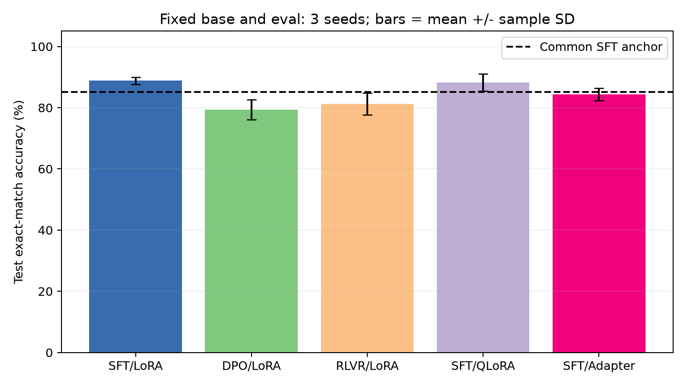
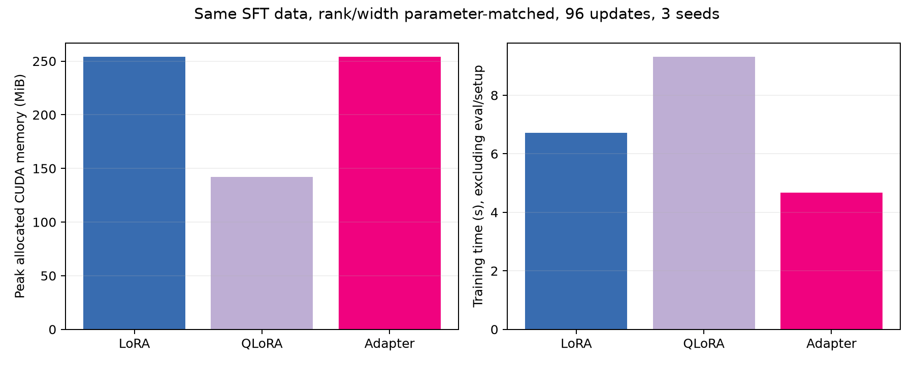
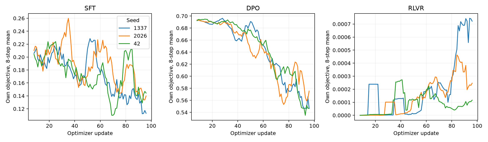

# 阶段五学习总结与阶段一至五体会

## 一、学习笔记

本次用 SFT 学习正确回复，DPO 比较正确与错误回复，RLVR 则对模型实际采样的回答验分。三种目标的 loss 定义不同，最终统一看同一测试集上的生成准确率。

LoRA 和 Adapter 训练少量增量参数，QLoRA 还将冻结基座压成 NF4。本轮三个 PEFT 方案均有 442,368 个可训练参数。

## 二、大作业进展情况

阶段五复用阶段三约 8555 万参数 GPT 和 BPE tokenizer，完成共享 SFT 预热，合并为固定基座后，运行 5 个实验臂 × 3 seeds，共 15 次正式训练。整数比较数据按题目分为训练 768、验证 128、测试 128 条。各实验训练 96 步，测试从完整词表贪心生成最多 2 tokens，不限制答案候选。

| 方法 | 测试准确率 %，均值±SD | 训练峰值显存 MiB | 训练秒 | 相对 SFT-LoRA 掉点 pp |
| --- | --- | --- | --- | --- |
| SFT-LoRA | 88.80 ± 1.19 | 254.3 | 6.72 | 0.00 |
| DPO-LoRA | 79.43 ± 3.25 | 261.5 | 13.38 | 9.38 |
| RLVR-LoRA | 81.25 ± 3.58 | 428.1 | 14.69 | 7.55 |
| SFT-QLoRA | 88.28 ± 2.82 | 142.2 | 9.32 | 0.52 |
| SFT-Adapter | 84.38 ± 2.07 | 254.3 | 4.68 | 4.43 |

共享预热基座准确率为 85.16%。按预先设定的超过 2.5 pp 掉点门槛，本次保留 LoRA 与 QLoRA，DPO、RLVR 和 Adapter 下岗。这些结论只适用于本次小规模整数比较任务，不能据此认定方法的普遍优劣。

RTX 4070 Ti 上，显存采用 PyTorch peak allocated，训练时间排除加载与评测，包含 RLVR rollout。上表为三 seed 均值，准确率另列样本 SD；更新数相同，三种后训练的计算量并不相等。

各面板的 loss 只能观察各自训练变化，不能比较绝对高低。训练日志、逐题输出和增量 checkpoint 均已保存，五个实验臂各重载一份 checkpoint 后，生成结果与原记录一致。

## 三、存在的问题与下一步计划

RLVR 采样曾因 `<unk>` 解码失败而中断，已将无效回答计为零奖励并补上测试。任务目前只有整数比较，三个 seed 共用一次预热，无法代表广泛任务表现。下一步扩大任务，分别预热不同 seed，并补等计算预算对照。QLoRA 本轮省显存但耗时更长；Adapter 的掉点区间跨零，当前淘汰属于预设门槛下的工程选择。

## 四、总结体会和意见建议

| 阶段 | 本阶段留下的经验 |
| --- | --- |
| 一 · Tokenizer | BPE 和 Unigram 的压缩率不同，先保证可逆，再检验是否有利于后续任务。 |
| 二 · GPT | 因果掩码与标签移位要先正确，loss 下降后还需要直接检查生成文本。 |
| 三 · 预训练 | 配置、数据划分与 checkpoint 决定能否复现，短训练的 PPL 下降不足以证明广泛能力。 |
| 四 · 系统与 scaling | 内核先测正确性；前向微基准加速不能直接当作整机训练收益，外推需要留出规模验证。 |
| 五 · 后训练 | 方法名称不能决定取舍，统一 eval 后再按准确率、显存和时间选择。 |

## 材料与数据

参考 [项目 GitHub 仓库](https://github.com/SakuraDanceMoo/full-chain-training-of-large-models/)。
